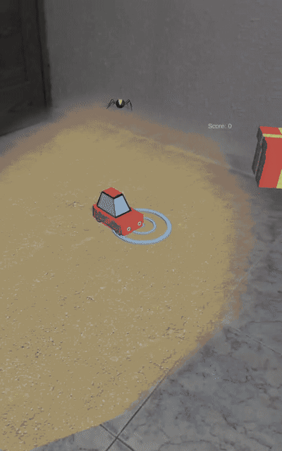

# AR Car Game – Unity AR Foundation

## AR

## functionality

First the camera and ARCore are used to detect a horizontal surface.

A reticle is displayed over the detected surface to show where the AR system is tracking.

The detected plane is locked so that the presents and spiders can spawn randomly within its boundaries.

The car follows the reticle, and its collisions with the presents and spiders trigger the scoring mechanics.

The presents and spiders are prefabs, which makes it possible to spawn new objects whenever the previous ones are collected or hit.

## Scripts

### DrivingSurfaceManager.cs

It manages the AR planes detected by AR Foundation.

It gets references to the `ARPlaneManager` and `ARRaycastManager` components from the XR Origin.

When the car is placed, the script locks the selected plane and disables the other detected planes, like new planes detected afterwards.

It also keeps track of the locked plane in case AR Foundation updates or merges it with another plane.

### ReticleBehaviour.cs

It controls the AR reticle.

It performs a raycast from the centre of the screen to check if the camera is pointing at a detected plane.

When a plane is found the reticle moves to the detected position and its rotation is updated to match the surface.

It saves a reference to the currently detected plane. This information is used by the other scripts when placing the car and locking the driving surface.

### CarManager.cs

It is responsible for creating the car.

It checks if the reticle has detected a valid plane. When a valid plane is available and no car exists yet, it instantiates the car prefab.

It also assigns the reticle reference to the car so that the car knows which position it should follow.

After spawning the car, it calls `LockPlane()` from the DrivingSurfaceManager.

The car appears automatically.

### CarBehaviour.cs

It controls the car's movement.

It constantly checks the position of the reticle and moves the car towards it using `Vector3.MoveTowards()`.

The car also rotates towards its target using `Quaternion.Lerp()`, which makes its movement look smoother.

The script gives the car a speed value that can be adjusted in the Inspector.

### PackageSpawner.cs

It is responsible for spawning the presents.

It waits until the driving surface is locked. Then it creates a present prefab at a random position on that plane.

To calculate random positions, it uses the mesh of the detected AR plane and selects a random point inside one of its triangles.

When a present is collected and destroyed, the script detects that the previous present no longer exists and creates another one.

This means there is always a present available on the playing surface.

### PackageBehaviour.cs

It controls what happens when the car collects a present.

It uses `OnTriggerEnter()` to detect collisions with other objects.

The car has the `Player` tag, so the script checks whether the object entering the trigger belongs to the player.

When the car touches the present:
- the score increases by 1
- the present is destroyed
- the PackageSpawner creates another present

A boolean variable called `collected` prevents the same present from being collected more than once.

### respawn.cs

It spawns and respawns the spiders.

It works similar to PackageSpawner. It waits until the driving surface has been locked and then creates a spider prefab at a random position on the plane.

The script saves a reference to the currently spawned spider.

When the spider is destroyed the reference is cleared. The next time the script checks for an existing spider, it creates a new one.

This keeps a spider available in the game.

### spiderBehav.cs

It controls the spider's collision behaviour.

It uses `OnTriggerEnter()` to detect when the car touches the spider.

The car is identified using the `Player` tag.

When a collision occurs:
- The score decreases by 1.
- The spider is destroyed.
- The spider spawner is notified so that another spider can appear.

It uses a boolean variable to prevent the same collision from being processed more than once.

### score.cs

This script manages the game's score.

It uses a static `Instance` reference so that other scripts can access the score manager.

The `AddPoints()` method receives a number and adds it to the current score.

- Collecting a present calls `AddPoints(1)`.
- Touching a spider calls `AddPoints(-1)`.

The script uses TextMeshPro to display the score on the screen. Every time the score changes, the text is updated automatically.

### prefabs

The car, presents and spiders are instantiated from prefabs.

The presents and spiders use colliders with Is Trigger enabled so that collisions can be detected without physically blocking the car.

The car uses the `Player` tag, which is checked by both the present and spider scripts.

### score 

The score is displayed using a TextMeshPro UI element inside a Canvas.

The ScoreManager object contains the `score` script, and its Score Text field is connected to the TextMeshPro object in the Inspector.

# RA

## RA

## Funcionalidad

Primero, se utilizan la cámara y ARCore para detectar una superficie horizontal.

Se muestra un retículo sobre la superficie detectada para indicar dónde está realizando el seguimiento el sistema de RA.

El plano detectado se bloquea para que los regalos y las arañas puedan aparecer aleatoriamente dentro de sus límites.

El coche sigue la posición del retículo y sus colisiones con los regalos y las arañas activan el sistema de puntuación.

Los regalos y las arañas son prefabs, lo que permite generar nuevos objetos cada vez que los anteriores se recogen o se golpean.

## Scripts

### DrivingSurfaceManager.cs

Este script gestiona los planos detectados por AR Foundation.

Obtiene referencias a los componentes `ARPlaneManager` y `ARRaycastManager` del XR Origin.

Cuando se coloca el coche, el script bloquea el plano seleccionado y desactiva los demás planos, incluidos los que se detecten posteriormente.

También mantiene una referencia al plano bloqueado por si AR Foundation lo actualiza o lo combina con otro plano.

### ReticleBehaviour.cs

Este script controla el retículo de RA.

Realiza un raycast desde el centro de la pantalla para comprobar si la cámara está apuntando a un plano detectado.

Cuando encuentra un plano, el retículo se mueve a la posición detectada y actualiza su rotación para adaptarse a la superficie.

Guarda una referencia al plano detectado en ese momento. Esta información es utilizada por los demás scripts para colocar el coche y bloquear la superficie de conducción.

### CarManager.cs

Este script se encarga de crear el coche.

Comprueba si el retículo ha detectado un plano válido. Cuando hay un plano disponible y todavía no existe ningún coche, instancia el prefab del coche.

También asigna al coche una referencia al retículo para que sepa qué posición debe seguir.

Después de generar el coche, llama al método `LockPlane()` de DrivingSurfaceManager.

El coche aparece automáticamente.

### CarBehaviour.cs

Este script controla el movimiento del coche.

Comprueba constantemente la posición del retículo y mueve el coche hacia ella utilizando `Vector3.MoveTowards()`.

El coche también gira hacia su objetivo utilizando `Quaternion.Lerp()`, lo que hace que el movimiento sea más suave.

El script incluye un valor de velocidad que se puede modificar desde el Inspector.

### PackageSpawner.cs

Este script se encarga de generar los regalos.

Espera hasta que la superficie de conducción esté bloqueada. Después, crea un prefab de regalo en una posición aleatoria sobre ese plano.

Para calcular las posiciones aleatorias, utiliza la malla del plano detectado y selecciona un punto aleatorio dentro de uno de sus triángulos.

Cuando se recoge y destruye un regalo, el script detecta que el objeto anterior ya no existe y genera otro.

De esta manera, siempre hay un regalo disponible en la superficie de juego.

### PackageBehaviour.cs

Este script controla lo que ocurre cuando el coche recoge un regalo.

Utiliza `OnTriggerEnter()` para detectar las colisiones con otros objetos.

El coche tiene la etiqueta `Player`, por lo que el script comprueba si el objeto que entra en el área de colisión pertenece al jugador.

Cuando el coche toca un regalo:
- La puntuación aumenta en 1 punto.
- El regalo se destruye.
- PackageSpawner genera otro regalo.

Una variable booleana llamada `collected` evita que el mismo regalo se recoja más de una vez.

### respawn.cs

Este script se encarga de generar y volver a generar las arañas.

Funciona de forma similar a PackageSpawner. Espera hasta que la superficie de conducción esté bloqueada y después crea un prefab de araña en una posición aleatoria sobre el plano.

El script guarda una referencia a la araña que se ha generado.

Cuando la araña se destruye, se elimina esa referencia. La siguiente vez que el script comprueba si existe una araña, genera otra nueva.

Así siempre hay una araña disponible en el juego.

### spiderBehav.cs

Este script controla el comportamiento de las colisiones con las arañas.

Utiliza `OnTriggerEnter()` para detectar cuándo el coche toca una araña.

El coche se identifica mediante la etiqueta `Player`.

Cuando se produce una colisión:
- La puntuación disminuye en 1 punto.
- La araña se destruye.
- Se notifica al generador de arañas para que aparezca otra.

Utiliza una variable booleana para evitar que la misma colisión se procese más de una vez.

### score.cs

Este script gestiona la puntuación del juego.

Utiliza una referencia estática llamada `Instance` para que los demás scripts puedan acceder al gestor de puntuación.

El método `AddPoints()` recibe un número y lo suma a la puntuación actual.

- Recoger un regalo llama a `AddPoints(1)`.
- Tocar una araña llama a `AddPoints(-1)`.

El script utiliza TextMeshPro para mostrar la puntuación en pantalla. Cada vez que cambia la puntuación, el texto se actualiza automáticamente.

### Prefabs

El coche, los regalos y las arañas se instancian a partir de prefabs.

Los regalos y las arañas utilizan colliders con la opción `Is Trigger` activada para detectar las colisiones sin bloquear físicamente el movimiento del coche.

El coche utiliza la etiqueta `Player`, que es comprobada por los scripts de los regalos y las arañas.

### Puntuación

La puntuación se muestra mediante un elemento de interfaz de usuario de TextMeshPro dentro de un Canvas.

El objeto ScoreManager contiene el script `score`, y su campo Score Text está conectado al objeto TextMeshPro correspondiente desde el Inspector.

